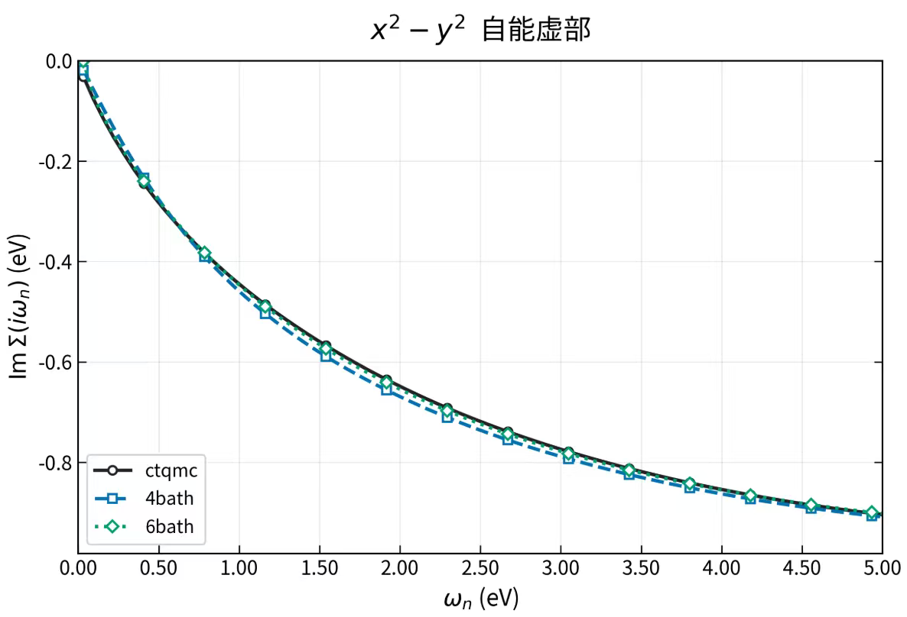
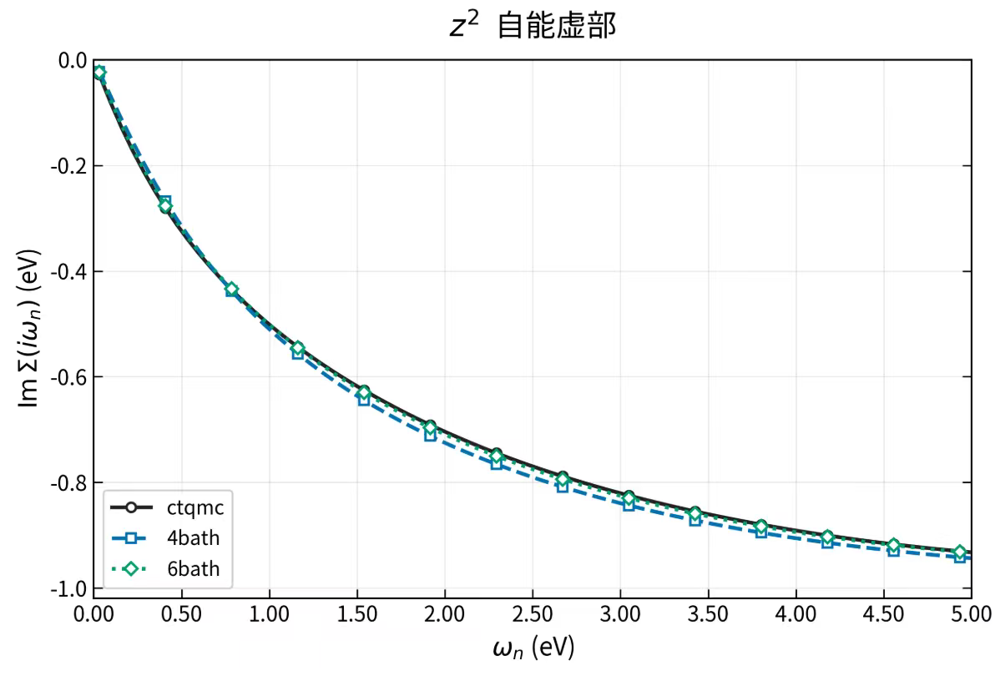
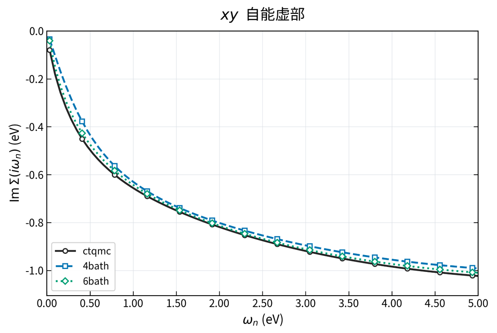
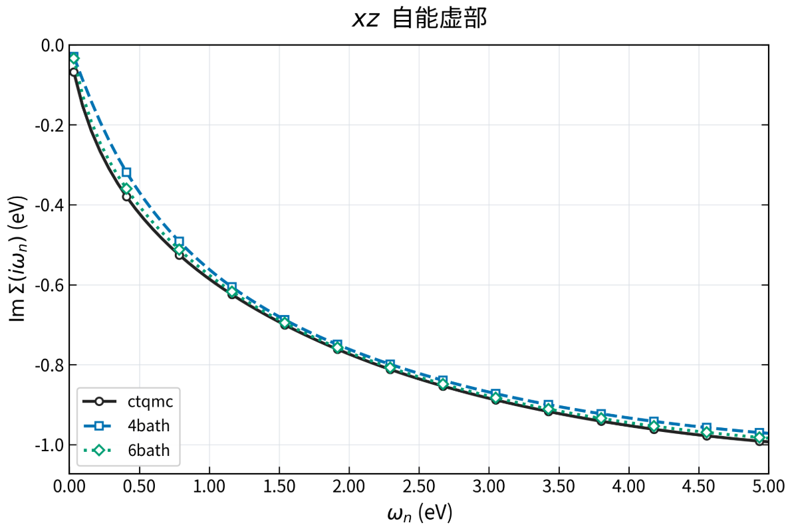
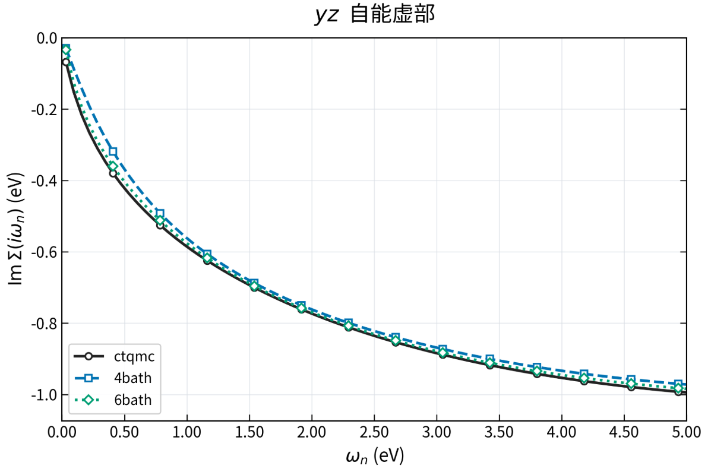

# 6 bath orbitals per spin-orbital channel

## Program overview

eDMFT + NORG (natural orbital renormalization group) can be used to study paramagnetic materials with 2, 3, or 5 orbitals, such as five-orbital FeSe.

In the five-orbital FeSe example, each spin-orbital channel has 6 bath orbitals. The first row below gives the excitation constraints for the wide constraint set. The next 10 rows give the orbital partition for each spin-orbital channel.

```text
 0 -1 -3 -4 -5  0  5  4  3  1
 1  0  0  0  3  1  2  0  0  0
 1  0  0  0  3  1  2  0  0  0
 1  0  0  0  3  1  2  0  0  0
 1  0  0  0  3  1  2  0  0  0
 1  0  0  0  3  1  2  0  0  0
 1  0  0  0  3  1  2  0  0  0
 1  0  0  0  3  1  2  0  0  0
 1  0  0  0  3  1  2  0  0  0
 1  0  0  0  3  1  2  0  0  0
 1  0  0  0  3  1  2  0  0  0
```

Under these wide constraints, the sparse Hamiltonian matrix H has 5.8 billion nonzero entries. On **2 standard compute nodes**, the full NORG calculation (ground state and Green’s function) takes about **1 hour and 20 minutes**.

## Imaginary parts of the self-energies for the five FeSe orbitals (CT-QMC and NORG benchmark with 4 and 6 bath orbitals per orbital in NORG)

The black line is the CT-QMC reference. The blue and green lines show the NORG results with 4 and 6 bath orbitals, respectively.











## `params.dat` parameters for paramagnetic eDMFT + NORG

Supports 2, 3, or 5 orbitals.

### eDMFT control parameters

| Parameter | Current value | Purpose |
| --- | --- | --- |
| `solver` | `'NORG'` | Selects the NORG impurity solver. |
| `DCs` | `'exact'` | Selects the double-counting correction scheme. |
| `max_dmft_iterations` | `1` | Maximum number of DMFT iterations per outer cycle. |
| `max_lda_iterations` | `100` | Maximum number of LDA charge iterations per outer cycle. |
| `finish` | `200` | Maximum number of outer charge self-consistency cycles. |
| `ntail` | `300` | Number of high-frequency tail sampling points on the self-energy mesh. |
| `cc` | `5e-6` | Charge convergence threshold. |
| `ec` | `5e-6` | Total energy convergence threshold (Ry). |
| `recomputeEF` | `1` | `0` holds the Fermi level fixed, `1` recalculates it, and `2` searches for a gap. |

### Impurity model and bath fitting (`iparams0`)

| Parameter | Current value | Purpose |
| --- | --- | --- |
| `exe` | `'FeSe_diagonal_paramagnetism'` | Executable invoked from `WIEN_DMFT_ROOT`. |
| `U` | `5.0` eV | Local Coulomb interaction parameter. |
| `J` | `0.8` eV | Hund’s exchange parameter. |
| `CoulombF` | `"'Ising'"` | Uses a density–density interaction. |
| `beta` | `100` eV⁻¹ | Inverse temperature, corresponding to about 116 K. |
| `nom` | `120` | Number of consecutive low-frequency points retained on the self-energy mesh. |
| `nf0` | `6.0` | Nominal shell occupancy used for the double-counting correction. For Fe, use d⁶. |
| `Minsulator` | `1` | `1` accounts for degeneracy in the ground-state density matrix calculation. `0` uses the standard update. |
| `fit_nbaths` | Ten entries of `6` | Number of bath orbitals per spin channel. In the paramagnetic case, the spin-up and spin-down values are equal for each pair. |
| `fit_points` | `[0,1,2,3,4,5,7,9,13,18,25,33,63,94,157,226,361]` | Zero-based indices of the imaginary-frequency points used to fit the hybridization function. |

### Orbital partitions and subspaces (`iparams0`)

| Parameter | Current value | Purpose |
| --- | --- | --- |
| `NOOC` | `'phss_v2'` | Selects many-body configurations using particle and hole excitation constraints. |
| `restrain` | `[0,-1,-3,-4,-5,0,5,4,3,1]` | Excitation constraints for each partition. The array length determines the number of columns. |
| `restrain_autonooc` | `2` | Selects the mirrored bath columns for automatic partitioning. In this example, their indices are `2` and `8`. |
| `restrain_tight_divs` | Same as `restrain` | Tight constraints used during Green’s function preconvergence. |
| `weight_freze` | Five entries of `-1e-7` | Occupation-weight threshold for frozen orbitals. With the current negative value, no orbitals are classified as frozen. |
| `weight_nooc` | Five entries of `-1` | Occupation-weight threshold for restricted orbitals. With the current negative value, no orbitals are classified as restricted. |
| `if_fix_N_subspace` | `0` | `0` searches automatically. `1` uses the predefined subspace. |
| `ful_pcl_sch` | `1` | During automatic search, `1` searches all groups jointly and `0` searches adaptively by group. |
| `or_deg_adaptive` | `[1,1,2,2,3,3,4,4,5,5]` | Group labels for the search. In this example, the two spin channels of each orbital belong to the same group. |
| `cix_map` | `[1,1,[1,2]]` | Uses the mean occupancy of lattice blocks `1` and `2` to initialize the paramagnetic calculation. |
| `if_n_init` | `1` | When no restart record is available, `1` estimates the starting point from the lattice occupancy and `0` uses the manual starting point. |
| `fix_start_search_N_subspace` | Ten entries of `4` | Manual starting point for the search. Each entry gives the total number of particles on the impurity and bath orbitals in that channel. |
| `fix_N_subspace` | 1 subspace, `N=4` in each channel | For fixed-subspace mode, specify the number of subspaces, the particle counts and partitions for each subspace, and comments. |

## Installation

1. From the directory containing `iNORG_FeSe_diagonal_paramagnetism` and `eDMFT-master-python3`, compile NORG and install the executable and the two Python interface scripts in the eDMFT `bin` directory.

   ```bash
   use_edmft_py3
   cd iNORG_FeSe_diagonal_paramagnetism
   make clear && make clean && make
   cp FeSe_diagonal_paramagnetism ../eDMFT-master-python3/bin/
   cp edmft/norg_fese_diagonal_paramagnetism.py edmft/run_dmft_new_fese_diagonal_paramagnetism.py ../eDMFT-master-python3/bin/
   ```

2. From the current directory, copy the four configuration files to the prepared eDMFT calculation directory for the material. Replace the path below with the actual path to the `FeSe` directory.

   ```bash
   case_dir="/actual/path/to/FeSe"
   cp mpi_prefix.dat mpi_prefix.dat2 params.dat slurm.bscc.t6.txt "$case_dir/"
   ```

   The default two-node submission script also calls `run_solver_mpi.sh` and `solver_runtime.sh` in the material directory. If they are missing, copy both scripts from a verified two-node calculation and make sure `run_solver_mpi.sh` is executable.

3. Enter the material directory and submit the job.

   ```bash
   cd "$case_dir"
   sbatch --export=ALL,STEP=run_dmft_new_fese_diagonal_paramagnetism slurm.bscc.t6.txt
   ```
